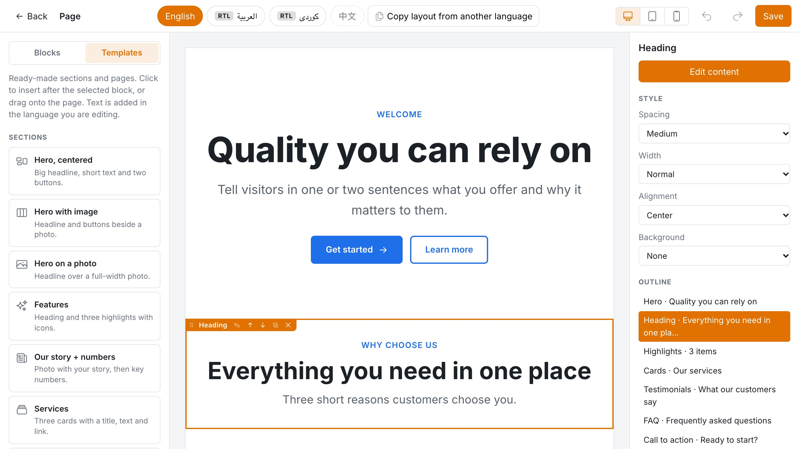
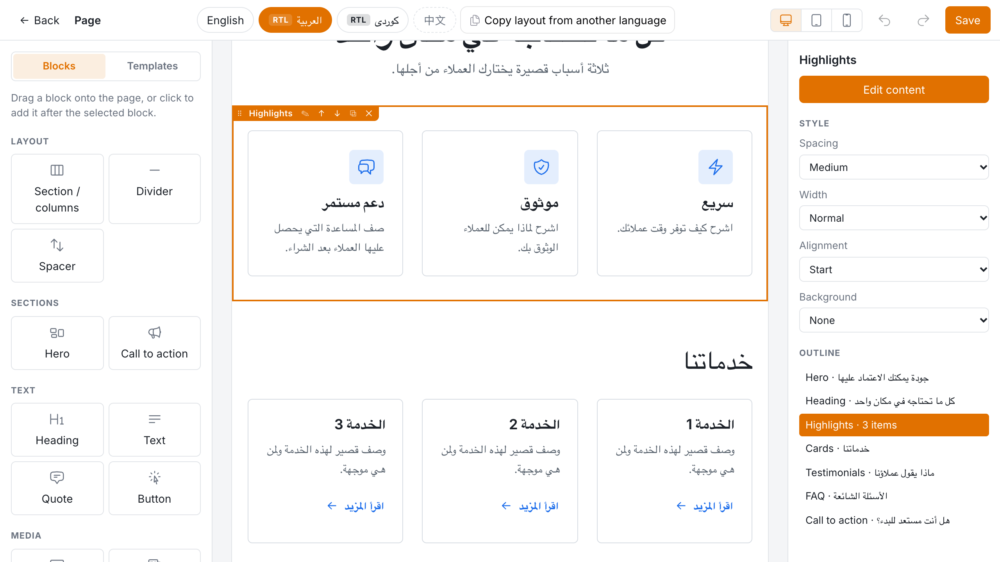
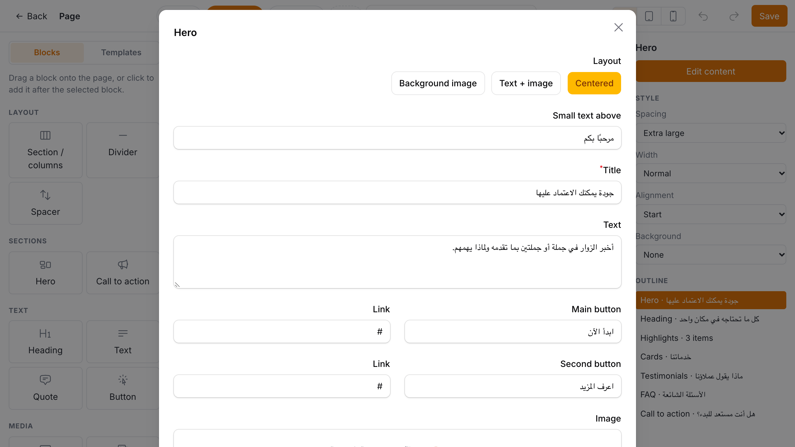
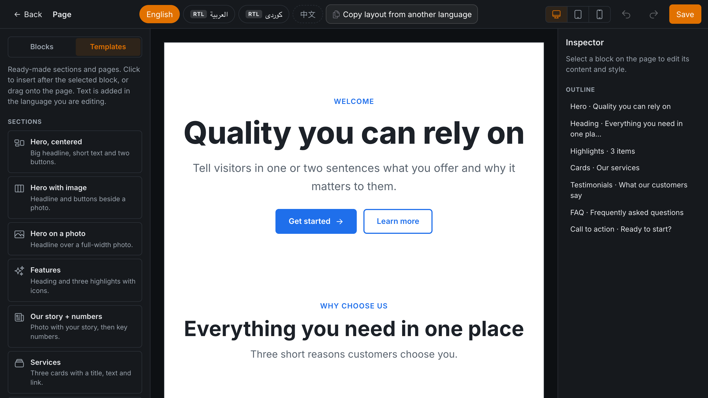
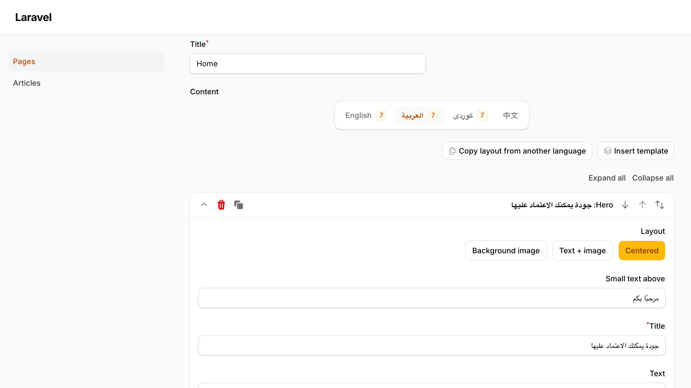

# Ferga-Builder

[](https://github.com/shadcs/ferga-builder-mutlilanguage-rtl-support/actions/workflows/tests.yml)
[](https://packagist.org/packages/shadcs/ferga-builder-mutlilanguage-rtl-support)
[](LICENSE)

A drag-and-drop visual page builder for [Filament](https://filamentphp.com) with **multilingual content**, **right-to-left (RTL) support** and **ready-made templates**.



- **Visual canvas:** drag blocks onto a live preview, put them in columns, then style, reorder, undo/redo and save
- **Templates:** 11 ready-made sections and 4 full pages (landing, product, about, services). Sample text is inserted in the language you are editing.
- **20 blocks:** hero, call to action, FAQ, cards, testimonials, logos, columns, text, images, gallery, video and more
- **Every language has its own blocks**, with fallback to the default language and "copy layout from another language"
- **RTL that works:** `dir`/`lang` per language, CSS logical properties, and arrows that mirror for Arabic, Kurdish, Persian, Hebrew and Urdu
- **Editor UI** in English, العربية, کوردی (Sorani) and 中文
- **Flat, themable CSS** with no shadows and no build step for your app
- **Pluggable storage:** a JSON column, a column per language, or your own translations table

Requires PHP 8.3+, Laravel 11.28+ / 12 / 13 and Filament 4.13+ or 5.8+.

| Templates | Arabic (RTL) |
| --- | --- |
|  |  |
| **Block form in a modal** | **Dark mode** |
|  |  |

---

## Installation

```bash
composer require shadcs/ferga-builder-mutlilanguage-rtl-support
php artisan filament:assets
```

`filament:assets` copies the editor styles into `public/`. Most Filament apps already run it after every `composer update` (`@php artisan filament:upgrade`).

Register the plugin in your panel:

```php
use Ferga\FilamentBuilder\FergaBuilderPlugin;

public function panel(Panel $panel): Panel
{
    return $panel
        // ...
        ->plugin(
            FergaBuilderPlugin::make()
                ->locales(['en' => 'English', 'ar' => 'العربية', 'ku' => 'کوردی', 'cn' => '中文'])
                ->defaultLocale('en')
        );
}
```

Your public site doesn't boot the panel, so publish the config and set the same languages there:

```bash
php artisan vendor:publish --tag=ferga-builder-config
```

```php
// config/ferga-builder.php
'locales' => ['en' => 'English', 'ar' => 'العربية', 'ku' => 'کوردی', 'cn' => '中文'],
'default_locale' => 'en',
```

You can also set them in a service provider from your existing language config:

```php
app(\Ferga\FilamentBuilder\FergaBuilder::class)
    ->setLocales(config('app.available_locales'))
    ->setDefaultLocale('en');
```

---

## Usage

### 1. A JSON column

```php
Schema::table('pages', fn (Blueprint $table) => $table->json('content')->nullable());
```

```php
use Ferga\FilamentBuilder\Concerns\HasBuilderContent;

class Page extends Model
{
    use HasBuilderContent;

    protected $casts = ['content' => 'array'];
}
```

The column stores `{"en": [...blocks], "ar": [...blocks]}`. A column that already holds a plain list of blocks is read as default-language content.

### 2. The form field

```php
use Ferga\FilamentBuilder\Forms\Components\PageBuilder;

PageBuilder::make('content')
    // ->blocks(['hero', 'rich_text', 'image'])   only these block types
    // ->locales(['en', 'ar'])                    only these languages (others are kept on save)
    // ->templates(false)                         hide "Insert template"
    // ->copyLayout(false)                        hide "Copy layout from another language"
```



The field has one tab per language, and right-to-left languages are edited RTL. Each tab has **Insert template** and **Copy layout from another language** buttons, and an empty language shows a note that visitors will see the default language instead.

### 3. The visual canvas

```php
use Ferga\FilamentBuilder\Filament\Pages\BuilderCanvas;

class PageBuilderCanvas extends BuilderCanvas
{
    protected static string $resource = PageResource::class;

    // protected static string $contentField = 'content';
}
```

```php
// PageResource::getPages()
'builder' => PageBuilderCanvas::route('/{record}/builder'),

// EditPage::getHeaderActions()
\Ferga\FilamentBuilder\Filament\Actions\OpenCanvasAction::make(),
```

The canvas includes:

- **Blocks** and **Templates** tabs: drag onto the page, or click to insert after the selected block
- a live preview that uses your public block views, shown in the language's direction
- sections with 1–4 columns: drag blocks into and between columns
- an inspector with **Edit content** (the block's Filament form in a modal), style options and column layouts
- an outline of the page, a language switcher, **Copy layout**, and a notice for empty languages
- undo/redo (<kbd>Ctrl/⌘ Z</kbd>, <kbd>Ctrl/⌘ Shift Z</kbd>), <kbd>Ctrl/⌘ S</kbd> to save, <kbd>Delete</kbd> and <kbd>Esc</kbd>
- desktop, tablet and mobile preview widths, plus dark mode

Access uses the resource's `canEdit()` policy.

### 4. Rendering on your site

```blade
<head>
    <x-ferga-builder::styles />   {{-- inlines the CSS, or links it once published --}}
</head>

<x-ferga-builder::blocks :record="$page" field="content" />
{{-- or --}}
<x-ferga-builder::blocks :blocks="$page->content" :locale="app()->getLocale()" class="my-page" />
```

```html
<div class="fb-content my-page" dir="rtl" lang="ar" data-locale="ar"> … </div>
```

- If a language has no blocks, the default language is shown. `dir`/`lang` follow the language actually shown, and the wrapper gets `data-fallback="true"`.
- Unknown block types are skipped. Render errors are reported and skipped in production, and thrown when `app.debug` is on.
- To link the stylesheet instead of inlining it, run `php artisan vendor:publish --tag=ferga-builder-assets`. Add it to `post-update-cmd` with `--force` to keep it current.

```php
$page->renderBuilder('content', 'ar');          // HtmlString
$page->builderBlocks('content', 'ar');          // array, with fallback
FergaBuilder::resolve($documents, 'ku');        // ['blocks', 'locale', 'fallback']
```

---

## Templates

| Sections | Full pages |
| --- | --- |
| Hero (centered, with image, on a photo) · Features · Our story + numbers · Services · Testimonials · FAQ · Client logos · Call to action · Contact strip | Landing page · Product page · About page · Services page |

Template text is translated (English, Arabic, Kurdish, Chinese) and inserted in the language being edited. A template that uses an unregistered block type leaves that block out.

Add your own:

```php
use Ferga\FilamentBuilder\Templates\Template;
use Ferga\FilamentBuilder\Templates\TemplateCopy;

FergaBuilderPlugin::make()->registerTemplates([
    Template::make('pricing')
        ->label(__('Pricing'))
        ->description(__('Three plans side by side.'))
        ->icon(Heroicon::OutlinedCurrencyDollar)
        ->category(Template::SECTION)            // or Template::PAGE
        ->blocks(fn (TemplateCopy $t, string $locale) => [
            ['type' => 'heading', 'data' => ['text' => __('Plans', locale: $locale), 'level' => 'h2']],
            ['type' => 'cards', 'data' => ['columns' => 3, 'items' => [/* … */]]],
        ]),
]);

// ->templates([...]) replaces the built-in templates, ->templates(false) removes them.
// Or set 'core_templates' => false in the config.
```

## Blocks

| Type | Group | Notes |
| --- | --- | --- |
| `section` | layout | 1–4 columns (`1`, `1-1`, `1-2`, `2-1`, `1-1-1`, `1-2-1`, `1-1-1-1`), gap, vertical alignment |
| `hero` | sections | centered, text + image, or text over a photo; two buttons |
| `call_to_action` | sections | title, text, two buttons; brand-colour background by default |
| `heading` | text | eyebrow, text, subtitle, H1–H4 |
| `rich_text` | text | Filament RichEditor |
| `quote` | text | text, author, role |
| `button` | text | filled / outline / link, arrow, new tab |
| `image`, `image_text`, `gallery` | media | alt text, captions, links |
| `video` | media | YouTube/Vimeo links become `youtube-nocookie` / `player.vimeo.com?dnt=1` embeds |
| `logos` | media | partner logos, grey until hovered |
| `highlights` | content | items with Heroicons |
| `cards` | content | image, title, text, link |
| `stats` | content | value + label |
| `testimonials` | content | quote, name, role, photo (or initial) |
| `faq` | content | native `<details>` that works without JavaScript |
| `file_download` | content | shows file type and size |
| `divider`, `spacer` | layout | |

Every block has style options: **spacing** (`none`–`xl`), **width** (`narrow`, `normal`, `wide`, `full`), **alignment** (`start`, `center`, `end`) and **background** (`none`, `muted`, `primary`, `dark`).

### Custom blocks

```php
use Ferga\FilamentBuilder\Blocks\Block;
use Filament\Forms\Components\TextInput;

class AlertBlock extends Block
{
    public static function type(): string { return 'alert'; }

    public function label(): string { return __('Alert'); }

    public function icon(): string|\BackedEnum { return Heroicon::OutlinedExclamationTriangle; }

    public function schema(): array
    {
        return [TextInput::make('text')->required()];
    }

    public function view(): string { return 'blocks.alert'; }   // gets $data, $context, $locale, $isRtl
}

FergaBuilderPlugin::make()->registerBlocks([AlertBlock::class]);
```

You can also override `group()`, `defaults()` (data for new blocks on the canvas), `preview()` (outline text), `fileFields()` (supports `items.*.image`), `nestable()`, `canvasSchema()` and `viewData()`. Replacing a core block works too: register a class with the same `type()`.

## Theming

```css
.fb-content {
    --fb-primary: #0a7cff;
    --fb-primary-contrast: #fff;
    --fb-text: #1c2128;
    --fb-text-muted: #59636e;
    --fb-surface: #f3f4f6;   /* "muted" background */
    --fb-dark: #111418;      /* "dark" background */
    --fb-border: #d8dde3;
    --fb-radius: 6px;
    --fb-max-width: 72rem;
    --fb-font: inherit;
    --fb-heading-font: inherit;
}
```

To change the markup, publish the views: `php artisan vendor:publish --tag=ferga-builder-views`.

## Languages and RTL

- RTL languages are configurable. The default list is `ar, ku, ckb, fa, he, ur, ps, sd, yi, dv`, matched by prefix, so `ar_IQ` counts as RTL.
- `cn` maps to `lang="zh-CN"` and `ku` to `lang="ckb"`.
- Layout uses logical properties throughout, so columns, borders and alignment mirror automatically.
- The editor UI follows the admin's language, and the preview follows the content language.

## Storage

| Store | Use |
| --- | --- |
| `Storage\JsonColumnStore` (default) | one JSON column with all languages |
| `Storage\ColumnPerLocaleStore` | `content_en`, `content_ar`, … |
| `Storage\CallbackStore` | closures for anything else |
| your class implementing `Contracts\ContentStore` | `load(Model, field): array` / `save(Model, field, array)` |

To pick a store per model, implement `Contracts\HasBuilderContentStore`:

```php
class Post extends Model implements HasBuilderContentStore
{
    public function builderContentStore(string $field): ?ContentStore
    {
        return new MyTranslationsTableStore;   // e.g. Voyager-style `translations` table
    }
}
```

You can also pass a store to a single field (`PageBuilder::make('content')->store(...)`) or override `getContentStore()` on a canvas page. `FergaBuilder::files($documents)` lists every uploaded file a page uses, which helps clean up unused uploads.

## Translations

The editor and templates ship in `en`, `ar`, `ku` / `ckb` (Sorani) and `zh_CN` / `cn` / `zh`. Other languages fall back to your app's `fallback_locale`. To override strings:

```bash
php artisan vendor:publish --tag=ferga-builder-translations
```

Corrections from native speakers are welcome.

## Testing

```bash
composer test     # Pest + Testbench, boots a real Filament panel
composer lint     # Pint
```

CI runs on PHP 8.3 and 8.4, with Laravel 12 and 13 and Filament 4 and 5.

## Changelog, contributing, security

See [CHANGELOG](CHANGELOG.md) and [CONTRIBUTING](CONTRIBUTING.md). Please report vulnerabilities privately; see [SECURITY](SECURITY.md).

## Credits

- [Ferga Solutions](https://github.com/ferga)
- Inspired by Carl Janzell's MIT-licensed [filament-page-builder](https://filamentphp.com/plugins/carl-janzell-page-builder). Ferga-Builder is an independent implementation written from scratch and contains no code from that package.

## License

MIT. See [LICENSE](LICENSE).
